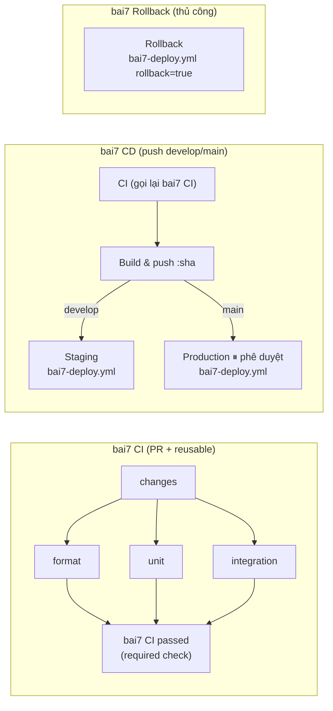
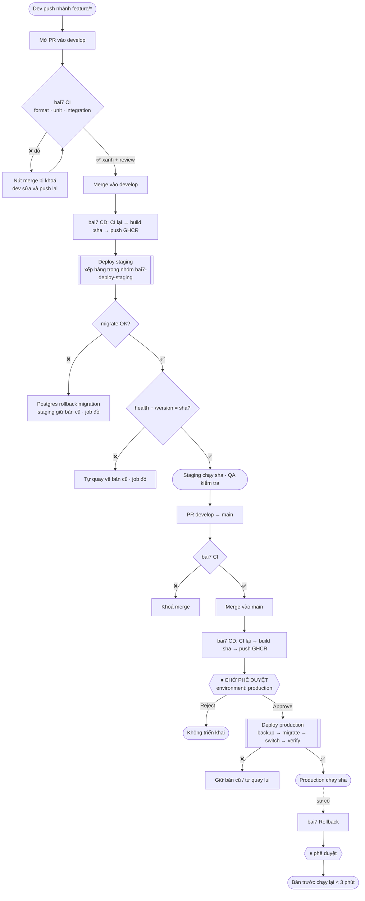

# Bài 7 – Pipeline nhiều môi trường cho ShopFast

| Thành phần | File |
|---|---|
| Kiểm tra PR (format, unit, integration) | [`.github/workflows/bai7-ci.yml`](../.github/workflows/bai7-ci.yml) |
| Build và triển khai theo nhánh | [`.github/workflows/bai7-cd.yml`](../.github/workflows/bai7-cd.yml) |
| Job triển khai dùng chung (deploy + rollback) | [`.github/workflows/bai7-deploy.yml`](../.github/workflows/bai7-deploy.yml) |
| Quay lui theo yêu cầu | [`.github/workflows/bai7-rollback.yml`](../.github/workflows/bai7-rollback.yml) |
| Script triển khai / quay lui | [`deploy/deploy.sh`](deploy/deploy.sh), [`deploy/rollback.sh`](deploy/rollback.sh), [`deploy/lib.sh`](deploy/lib.sh), [`deploy/compose.yml`](deploy/compose.yml) |
| Quy trình quay lui (runbook) | [`ROLLBACK.md`](ROLLBACK.md) |
| Kiểm thử end-to-end triển khai/quay lui | [`scripts/e2e-deploy-local.sh`](scripts/e2e-deploy-local.sh) |

---

# A. Phân tích và thiết kế

## A1. Phân tích bài toán: sự kiện kích hoạt → công việc → đầu ra

| # | Sự kiện (đầu vào) | Workflow | Công việc chạy | Đầu ra mong đợi |
|---|---|---|---|---|
| 1 | Mở / cập nhật **PR vào `develop` hoặc `main`** có thay đổi `bai7/` | `bai7 CI` | `changes` → `Format & type check` ∥ `Unit tests` ∥ `Integration tests (Postgres)` → `bai7 CI passed` | ✅ cả 3 xanh thì cho phép merge. ❌ một job đỏ thì check `bai7 CI passed` đỏ và **nút merge bị khoá** |
| 2 | PR **không** đụng `bai7/` (ví dụ bài 8, 9) | `bai7 CI` | `changes` → 3 job bị *skipped* → `bai7 CI passed` xanh | Không chặn PR của phần khác trong repo |
| 3 | Push mới lên PR đang chạy CI | `bai7 CI` | Lần chạy cũ bị huỷ (`cancel-in-progress`) | Chỉ kết quả của commit mới nhất có giá trị |
| 4 | **Merge vào `develop`** | `bai7 CD` | `CI` (chạy lại trên kết quả merge) → `Build & push :<sha>` → `Staging / Deploy staging` | Image `shopfast-bai7:<sha>` trên GHCR. **Staging tự động** chạy `<sha>`. Thẻ `staging` trỏ tới `<sha>` |
| 5 | **Merge vào `main`** | `bai7 CD` | `CI` → `Build & push :<sha>` → `Production / Deploy production` **⏸ chờ phê duyệt** | Run dừng ở *Waiting for review*. Người có quyền duyệt thì production chạy `<sha>`, từ chối thì không gì thay đổi |
| 6 | Hai merge vào cùng nhánh **gần như cùng lúc** | `bai7 CD` ×2 | Hai pipeline build song song, nhưng job deploy xếp hàng trong nhóm `bai7-deploy-<env>` | Không bao giờ có 2 deploy chồng nhau. Bản cũ hơn không ghi đè bản mới hơn |
| 7 | Migration lỗi giữa chừng trong lúc deploy | `bai7 CD` | `deploy.sh` dừng ở bước migrate | Postgres rollback toàn bộ migration đó. **Bản cũ tiếp tục chạy**, schema giữ nguyên. Job đỏ |
| 8 | Bản mới khởi động nhưng không healthy | `bai7 CD` | `deploy.sh` tự quay lại bản đang chạy trước đó | Môi trường trở về bản cũ. Job đỏ |
| 9 | Người vận hành chạy **bai7 Rollback** (chọn môi trường, có thể ghi SHA) | `bai7 Rollback` | `Rollback / Rollback <env>` (production cần duyệt) | Môi trường chạy lại bản trước (hoặc SHA chỉ định) trong **< 3 phút** |
| 10 | `workflow_dispatch` bai7 CD trên một nhánh | `bai7 CD` | Build lại và deploy head của nhánh đó (nếu là `develop`/`main`) | Dùng khi muốn triển khai lại mà không có commit mới |

## A2. Đề xuất giải pháp

**Ý tưởng chính:** build **một image duy nhất cho mọi môi trường**, gắn thẻ bằng commit SHA. Khác biệt giữa các môi trường chỉ nằm ở secrets và vars của **GitHub Environment**, được nạp lúc chạy.

**Chia việc thành 4 workflow, 9 job:**



| Job | Phụ thuộc | Vai trò |
|---|---|---|
| `changes` | – | Xác định PR có đụng `bai7/` không, để không chặn PR của phần khác |
| `format`, `unit`, `integration` | `changes` | Chạy **song song** cho nhanh. Integration test có service `postgres:16-alpine` |
| `bai7 CI passed` | cả 4 job trên (`if: always()`) | Check **duy nhất** mà branch protection yêu cầu. Đỏ nếu có job nào `failure`/`cancelled` |
| `ci` (trong CD) | – | Chạy lại toàn bộ CI trên kết quả **sau khi merge** |
| `build` | `ci` | Build và đẩy `ghcr.io/<owner>/shopfast-bai7:<sha>`, cache tầng Docker qua `type=gha` |
| `deploy-staging` | `build`, chỉ khi `develop` | Gọi `bai7-deploy.yml` với `environment: staging` |
| `deploy-production` | `build`, chỉ khi `main` | Gọi `bai7-deploy.yml` với `environment: production` (có required reviewers) |
| `rollback` | – (thủ công) | Gọi **cùng** `bai7-deploy.yml` với `rollback: true` |

Triển khai và quay lui dùng **chung một job** (`bai7-deploy.yml`), nên dùng chung khoá concurrency, chung secret và chung luật phê duyệt. Không có "đường tắt" nào bỏ qua các bước bảo vệ.

**Quản lý bí mật và biến môi trường:**

| Mục | Ở đâu | `staging` | `production` |
|---|---|---|---|
| Đăng nhập GHCR | `secrets.GITHUB_TOKEN` (GitHub tự cấp theo từng run, hết hạn khi job xong) | ← | ← |
| Mật khẩu DB | **Environment secret** `DB_PASSWORD` | giá trị riêng | giá trị riêng, khác staging |
| Cổng app | **Environment variable** `APP_PORT` | `8081` | `8082` |
| Ai được triển khai | Environment → *Deployment branches* | `develop`, `main` | chỉ `main` |
| Phê duyệt | Environment → *Required reviewers* | không | **có**, người có thẩm quyền |
| Nơi chạy deploy | Repo variable `DEPLOY_RUNS_ON` (tuỳ chọn) | mặc định `ubuntu-latest` | ← |
| DB cho CI | Container dùng một lần, `trust` auth | – | – |

Không có khoá nào nằm trong file YAML. Job CI chạy cho PR không thấy được secret của staging/production, vì chỉ job có khai báo `environment:` mới đọc được.

## A3. Thiết kế các bước: từ lúc đẩy mã tới production



**Các bước bên trong `deploy.sh`** (cả staging và production, trên CI hay chạy tay):

1. **Khoá môi trường** (`~/.shopfast/<env>.lock`). Nếu đang có deploy khác thì từ chối.
2. Đọc **bản đang chạy** từ thẻ con trỏ `<env>` trên GHCR (hoặc file trạng thái trên server).
3. Nếu bản cần deploy là **tổ tiên** của bản đang chạy (pipeline chậm hơn tới sau) thì **bỏ qua**, không ghi đè bản mới bằng bản cũ.
4. Pull `shopfast-bai7:<sha>`. Image phải tồn tại, tức là chỉ commit đã qua CI và đã build mới deploy được.
5. **Backup** `pg_dump` vào `~/.shopfast/backups/`.
6. **Migrate**: mỗi file một transaction, có advisory lock và `lock_timeout`. Lỗi thì dừng, bản cũ vẫn chạy.
7. **Đổi container** sang `<sha>` và chờ healthcheck. Kiểm tra `/version` phải trả đúng `<sha>`.
8. Hỏng thì **tự quay về bản cũ**. Thành công thì ghi `<env>-previous ← cũ`, `<env> ← sha`, cộng thêm `releases.log`.

---

# B. Triển khai và chống lỗi

## B1. Ứng dụng
API Express + TypeScript + Postgres ([src/](src/)): `GET /health`, `GET /version` (trả commit đang chạy), `GET/POST /products`. Migration là các file SQL trong [migrations/](migrations/), chạy bằng [src/migrate.ts](src/migrate.ts) như một bước riêng trước khi bản mới nhận traffic.

| Loại test | Số lượng | Nội dung |
|---|---|---|
| Format | – | `prettier --check` + `tsc --noEmit` |
| Unit | 15 | Validate dữ liệu, cấu hình, thứ tự migration, **phát hiện hai migration trùng số** (hai PR merge cùng lúc) |
| Integration (Postgres thật) | 9 | API; migration idempotent; **migration lỗi giữa chừng không để lại dấu vết**; **migration chỉ lỗi trên dữ liệu thật**; **hai lần migrate cùng lúc không đua nhau** |
| E2E triển khai (local) | 15 | `scripts/e2e-deploy-local.sh`: deploy, rollback có đo giờ, migration hỏng, bản không healthy, deploy chồng nhau |

## B2. Cấu hình chặn bẫy dữ liệu

### Bẫy 1: Hai PR được merge gần như cùng lúc

| Lớp | Cấu hình | Chặn được gì |
|---|---|---|
| 1 | `concurrency: { group: bai7-deploy-<env>, cancel-in-progress: false }` trong [bai7-deploy.yml](../.github/workflows/bai7-deploy.yml) | Deploy thứ hai **chờ** deploy thứ nhất xong. Không bao giờ huỷ deploy đang chạy dở. Rollback dùng **cùng nhóm** nên cũng không chen vào deploy |
| 2 | Kiểm tra `git merge-base --is-ancestor` trong [deploy.sh](deploy/deploy.sh) | Pipeline của merge #1 chậm hơn và tới sau merge #2: bị bỏ qua, không đưa production về bản cũ hơn |
| 3 | Khoá thư mục `~/.shopfast/<env>.lock` | Người chạy tay `deploy.sh` cùng lúc với CI |
| 4 | `pg_advisory_lock` trong [migrate.ts](src/migrate.ts) | Hai tiến trình migrate cùng lúc |
| 5 | Branch protection *Require branches to be up to date* + CD chạy lại CI sau khi merge | Hai PR riêng lẻ thì xanh nhưng gộp lại thì hỏng. Unit test chặn hai migration trùng số |

> GitHub chỉ giữ **một** job chờ trong mỗi nhóm concurrency. Nếu merge thứ 3 tới khi job thứ 2 còn đang chờ, job thứ 2 bị thay bằng job thứ 3. Điều này đúng ý muốn, vì commit mới nhất đã chứa mọi thay đổi trước đó.

Bằng chứng: E13–E15 (deploy chồng bị từ chối, khoá được nhả), integration test `two deploys migrating at the same moment do not race`, unit test `rejects two migrations with the same number`.

### Bẫy 2: Migration thất bại giữa chừng

| Lớp | Cấu hình | Tác dụng |
|---|---|---|
| 1 | Mỗi file migration chạy trong `BEGIN … COMMIT`. Postgres hỗ trợ DDL trong transaction | Lỗi ở câu lệnh thứ N thì cả N-1 câu trước cũng bị huỷ. Schema **hoặc ở bản cũ, hoặc ở bản mới**, không có trạng thái nửa vời. `schema_migrations` không ghi nhận file lỗi |
| 2 | Migrate **trước** khi đổi container | Migrate lỗi thì dừng. Container cũ chưa bị đụng tới và vẫn phục vụ |
| 3 | `pg_dump` trước khi migrate | Lưới an toàn cuối cùng nếu cần khôi phục dữ liệu (xem [ROLLBACK.md](ROLLBACK.md)) |
| 4 | `SET LOCAL lock_timeout = '10s'` | Migration không treo vô hạn sau các khoá do traffic thật giữ |
| 5 | Quy tắc **expand/contract**: mỗi release chỉ *thêm* (cột có default, bảng mới). Xoá hoặc đổi tên ở release sau | Code bản cũ chạy được trên schema mới, nên **quay lui app không cần migration ngược** |

Bằng chứng:
- Integration test `a migration that fails halfway leaves no trace`: bảng `half_done` đã được tạo và đã chèn 1 dòng trước khi lỗi, nhưng sau đó không còn.
- Integration test `a migration that only fails on real data`: `003` thêm cột `slug` rồi lỗi ở `UNIQUE(name)` vì dữ liệu trùng. Cột `slug` cũng bị huỷ. Migration này pass trên DB trống của CI, nên đây đúng là loại lỗi chỉ xuất hiện trên staging/production.
- E08–E10: deploy v3 lỗi ở migrate, v1 vẫn phục vụ, không có cột `slug`.

**Quy tắc viết migration cho đội** (dán vào template PR):
- Không `DROP`/`RENAME` cột mà bản đang chạy còn dùng. Tách thành 2 release.
- Cột mới phải `NULL` hoặc có `DEFAULT`.
- Không dùng lệnh không chạy được trong transaction (`CREATE INDEX CONCURRENTLY`, `VACUUM`) trong file migration thường.

## B3. Quay lui
Toàn bộ quy trình có trong **[ROLLBACK.md](ROLLBACK.md)**. Tóm tắt:
- **Chuẩn:** Actions → **bai7 Rollback** → *Run workflow* (from `main`) → chọn môi trường, để trống SHA thì về bản trước → duyệt (production) → xong.
- **Khẩn cấp trên server:** `bash deploy/rollback.sh production [sha]`.
- Đã đo ở local: **9 s** (file state) và **14 s** (registry state, giống CI).

---

# C. Cấu hình trên GitHub (làm một lần)

1. **Tạo nhánh `develop`**
   ```bash
   git switch main && git pull
   git switch -c develop && git push -u origin develop
   ```
2. **Settings → Environments → New environment `staging`**
   - *Deployment branches and tags*: **Selected branches** → thêm `develop` và `main`. Phải có `main` để chạy được Rollback cho staging, vì Rollback chạy từ `main`.
   - *Environment secrets*: `DB_PASSWORD` = chuỗi ngẫu nhiên, ví dụ `openssl rand -hex 24`.
   - *Environment variables*: `APP_PORT` = `8081`.
3. **New environment `production`**
   - ✅ **Required reviewers**: thêm người có thẩm quyền (ví dụ `vutungvn`). Nếu làm một mình thì **không** tick *Prevent self-review*.
   - *Deployment branches*: **Selected branches** → chỉ `main`.
   - `DB_PASSWORD` = một chuỗi ngẫu nhiên **khác** staging. `APP_PORT` = `8082`.
4. **Settings → Branches → Add branch ruleset** (hoặc *Add classic branch protection rule*) cho `develop` và `main`:
   - ✅ Require a pull request before merging.
   - ✅ Require status checks to pass → thêm **`bai7 CI passed`**. Tên check chỉ hiện ra sau khi nó đã chạy ít nhất 1 lần, nên hãy mở một PR trước.
   - ✅ Require branches to be up to date before merging.
   - Để ảnh chụp "khoá merge" rõ ràng, tick ✅ *Do not allow bypassing* (classic rule) hoặc để trống *Bypass list* (ruleset). Khi đó chính admin cũng không merge được PR đỏ.
   - ⚠️ Sau bước này **không push thẳng lên `main` được nữa** (kể cả bài 8, 9): phải đi qua PR.
5. Package `shopfast-bai7` xuất hiện ở tab **Packages** sau lần build đầu tiên. Mặc định package ở chế độ private, có thể đổi sang public trong *Package settings*.

---

# D. Kịch bản kiểm thử theo tiêu chí đánh giá

| ID | Tiêu chí | Cách làm | Kỳ vọng (chụp ảnh) |
|---|---|---|---|
| **T1** | PR có test lỗi bị khoá merge | `git switch -c feature/broken develop`, sửa `expect(res.status).toBe(200)` thành `201` trong `test/integration/api.spec.ts`, push, mở PR vào `develop` | `Integration tests` đỏ, `bai7 CI passed` đỏ. PR hiện **"Merging is blocked – Required statuses must pass"**. Đóng PR sau khi chụp |
| **T2** | Merge vào `develop` tự triển khai staging | `git switch -c feature/stock develop`, sửa nhỏ trong `bai7/` (ví dụ thêm sản phẩm vào seed bằng migration mới `003_...sql`), PR → xanh → merge | Run **bai7 CD**: `CI` → `Build` → `Staging / Deploy staging` chạy **tự động**. Summary ghi *Now serving `<sha>`*. Tab *Environments* → `staging` có deployment mới |
| **T3** | Merge vào `main` dừng chờ phê duyệt | Mở PR `develop` → `main`, CI xanh, merge | Run **bai7 CD** dừng ở `Production` với **"Waiting for review"**. Chụp ảnh, sau đó **Review deployments → Approve**. Job chạy xong, production chạy `<sha>` |
| **T4** | Mọi image có thẻ commit | Mở `github.com/vutungvn?tab=packages` → `shopfast-bai7` | Danh sách version có thẻ là **SHA 40 ký tự** cho mỗi lần build. Ngoài ra có thẻ con trỏ `staging`, `production`, `production-previous` |
| **T5** | Quay lui < 3 phút, ghi thời gian | Merge thêm một thay đổi lên `main` (để production có "bản trước"), sau đó **Actions → bai7 Rollback → Run workflow** (from `main`): environment = `production`, version để trống, reason = `demo T5` → Approve | Summary: *Now serving `<sha cũ>`*, *Previously `<sha mới>`*, *Script time Ns*. Ghi **thời gian job** (hiện ở góc phải job) vào bảng dưới |
| **T6** | Hai merge cùng lúc không chạy chồng | Merge 2 PR vào `develop` cách nhau vài giây (hoặc bấm *Run workflow* bai7 CD hai lần liền) | Job deploy thứ hai hiện *"Waiting for a pending job in the same concurrency group"* hoặc *"skip: … is an ancestor of the running …"* |
| T7 | Migration lỗi giữa chừng | Xem integration test (chạy trong mỗi CI) và `bash scripts/e2e-deploy-local.sh` (E08–E10) | Xem B2 |

### Bảng ghi thời gian quay lui

| Lần | Môi trường | Từ → về | Thời gian script | Thời gian job | Ghi chú |
|---|---|---|---|---|---|
| Local, file state | staging | v2 → v1 | 9 s | – | `scripts/e2e-deploy-local.sh` (E05–E06) |
| Local, registry state | production | v2 → v1 | 14 s | – | Cùng chế độ CI dùng (thẻ con trỏ trên registry) |
| GitHub Actions | production | `<sha mới>` → `<sha cũ>` | _điền_ | _điền_ | Tính từ lúc bấm Approve |

---

# E. Chạy ở máy local

```bash
cd bai7
npm ci
npm run format:check && npm run typecheck && npm run test:unit
docker compose up -d --wait                       # Postgres test ở cổng 15433
DATABASE_URL=postgres://postgres@localhost:15433/shopfast_test npm run test:integration
docker compose down -v
bash scripts/e2e-deploy-local.sh                  # 15 kịch bản deploy/rollback, tự dọn dẹp
```

# F. Giới hạn và hướng mở rộng
- **Nơi chạy môi trường:** mặc định job deploy chạy trên runner `ubuntu-latest` dùng một lần. `deploy.sh` thật sự dựng DB, migrate, đổi container và kiểm tra health trên runner đó, còn trạng thái "bản nào đang chạy" được lưu bằng thẻ trên GHCR. Với server thật, cài **self-hosted runner** trên server rồi đặt repo variable `DEPLOY_RUNS_ON=<label>` và `DEPLOY_STATE=file`; script giữ nguyên. Repo public thì nhớ bật *Require approval for all outside collaborators* để PR từ fork không chạy được trên server.
- Đổi container gây gián đoạn vài giây. Muốn zero-downtime thì thêm reverse proxy và chạy blue/green.
- Merge commit trên `main` có SHA khác `develop`, nên image production được build lại từ chính commit đó. Muốn "build một lần, promote" thì dùng fast-forward merge.
- Repo của tổ chức có thể bật **merge queue** thay cho *Require up to date*, đỡ phải rebase khi có 10 PR/ngày.
