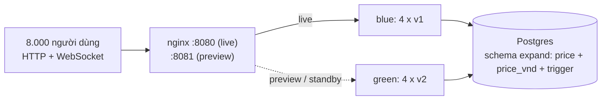

# Bài 8 – Chọn chiến lược triển khai cho giờ cao điểm (ShopFast)

**Kết luận:** chọn **Blue/Green**. Đây là chiến lược duy nhất đạt cả 3 ràng buộc với biên an toàn lớn:
- Gián đoạn **0 giây**.
- Quay lui **2,9 giây** (yêu cầu < 120 giây).
- Đỉnh **8 container**, đúng bằng trần ngân sách 2 × 4.

Cấu hình chạy được nằm trong thư mục này. Mọi con số "đo được" bên dưới đều có từ các script trong [scripts/](scripts/), chạy trên Docker Desktop.

---

# A. Phân tích và các giải pháp

## A1. Đầu vào / đầu ra

| Đầu vào | Giá trị | Ghi chú |
|---|---|---|
| Số container đang chạy `N` | 4 | sau một bộ cân bằng tải |
| Thời gian khởi động + sẵn sàng `T_start` | 25 s | mỗi container, các container khởi động **song song** được |
| Người dùng đồng thời `U` | 8.000 | ≈ 2.000 người/container, có kết nối realtime |
| Trần container trong lúc deploy | `2N` = **8** | tối đa thêm 4 |
| Quay lui tối đa | **120 s** | |
| Thời gian chuyển kết nối realtime `T_drain` | 30 s | do mình chọn: 2.000 kết nối/container ⇒ ≈ 67 lượt kết nối lại/giây/container |
| Smoke test `T_smoke` | ≈ 5 s | 8 request qua cổng preview |
| Đổi luồng ở LB `T_switch` | ≈ 1 s | `nginx -s reload` |
| Dừng/dọn một container `T_stop` | ≈ 3 s | |

| Đầu ra cần đạt | Cách đo |
|---|---|
| Không có lúc nào toàn hệ thống ngừng phục vụ | Số request HTTP lỗi trong lúc deploy, đo bằng [tools/traffic.mjs](tools/traffic.mjs) ở 40 req/s |
| Kết nối realtime không bị cắt đột ngột | Số WebSocket đóng bất thường (mã ≠ 1012) |
| Số container đỉnh ≤ 8 | `docker compose ps` trong lúc deploy |
| Thời gian hoàn tất, thời gian quay lui | Đồng hồ trong script |

## A2. Bốn chiến lược và phép tính

### (a) Recreate: dừng hết rồi khởi động bản mới
- **Container:** đỉnh **4** (thêm 0).
- **Thời gian:** `T_drain + T_start` = 30 + 25 = **55 s**. Dù có `kill -9` ngay thì vẫn tối thiểu `T_start` = 25 s.
- **Gián đoạn:** **toàn bộ 25–55 s**. Trong khoảng đó 8.000 người dùng không được phục vụ.
- **Quay lui:** chạy lại recreate với bản cũ, mất thêm **25–55 s gián đoạn**.
- **Đo được** (`T_drain` = 10 s): hoàn tất 37,4 s, **1.219/1.815 request lỗi**, khoảng lỗi kéo dài **36,9 s**, realtime không kết nối được trong 36,9 s.

### (b) Rolling update: thay cuốn chiếu (maxSurge = 1, maxUnavailable = 0)
- **Container:** đỉnh `N + 1` = **5** (thêm 1, tức 25 %).
- **Mỗi bước:** bật 1 bản mới (25 s), sau đó xả và dừng 1 bản cũ (30 s + 3 s) ⇒ ≈ 58 s/bước.
- **Thời gian:** 4 × 58 = **≈ 232 s (3 phút 52 giây)**.
- **Gián đoạn:** 0. Luôn có ≥ 4 container phục vụ.
- **Quay lui:** là một lần rolling theo chiều ngược lại, cũng **≈ 232 s > 120 s ✗**.
- **Biến thể maxSurge = 2:** đỉnh 6, mất 2 × 58 = 116 s, quay lui 116 s. Biên an toàn chỉ còn 3 %, chỉ cần một container khởi động chậm là trượt.
- **Đo được** (`T_drain` = 10 s): 4 bước × ~38 s = **152 s**, 0 request lỗi, đỉnh 5 container. Như vậy quay lui cũng mất ~152 s, vẫn **> 120 s**.

### (c) Blue/Green: dựng song song bản mới rồi chuyển luồng
- **Container:** đỉnh `2N` = **8** (thêm 4 = **100 %**, đúng bằng trần ngân sách).
- **Thời gian tới khi toàn bộ traffic sang bản mới:** migrate (≈ 1 s) + `T_start` (25 s, 4 container song song) + `T_smoke` (5 s) + `T_switch` (1 s) = **≈ 32 s**. Cộng thêm `T_drain` 30 s để chuyển hết realtime ⇒ ≈ 62 s.
- **Bản cũ giữ làm dự phòng nóng** trong cửa sổ quan sát `W` = 15 phút, sau đó dừng.
- **Gián đoạn:** 0.
- **Quay lui:** đổi luồng ngược lại trong khi bản cũ vẫn đang chạy ⇒ **≈ 1–3 s**. Nếu bản cũ đã bị dừng thì phải khởi động lại: `T_start` + `T_switch` ≈ **27–30 s**, vẫn < 120 s.
- **Chi phí thêm:** 4 container × (32 s + 15 phút) ≈ **1 container-giờ/lần deploy**.
- **Đo được** (bằng [e2e-blue-green.sh](scripts/e2e-blue-green.sh)):
  - deploy 36,8 s, đỉnh 8 container
  - **0 request lỗi** trên 3.065 request
  - **0 kết nối realtime bị cắt đột ngột** (180 lần chuyển êm)
  - quay lui **2,9 s** khi bản cũ còn chạy, **29,6 s** khi bản cũ đã bị dừng

### (d) Canary: phát hành dần cho một phần nhỏ người dùng
- **Container:** 1 canary + 4 cũ ⇒ đỉnh **5**. Canary nhận 1/5 = 20 % traffic, khoảng 1.600 người.
- **Thời gian:** 25 s (canary) + quan sát 5 phút + nâng phần còn lại bằng rolling 3 × 58 s ≈ **8–9 phút**.
- **Quay lui:** trong pha canary thì gỡ canary khỏi LB, mất **≈ 1–3 s ✓**. Sau khi đã nâng hết thì quay lui là rolling ngược, **≈ 232 s ✗**.
- **Gián đoạn:** 0. Cần LB chia trọng số và hệ thống đo lường để so sánh canary với bản cũ.

## A3. Phương án thực sự khác nhau về nguyên lý
- **(a)** thay **tất cả cùng lúc tại chỗ**.
- **(b)** thay **tại chỗ từng phần**, nên phiên bản thay đổi theo từng container.
- **(c)** dựng **môi trường song song** và đổi ở **tầng định tuyến**.
- **(d)** chia theo **tỷ lệ người dùng**.

Đây là 4 cơ chế khác nhau, không phải biến thể của một cơ chế.

---

# B. So sánh và lựa chọn

## B1. Bảng so sánh

| Tiêu chí | (a) Recreate | (b) Rolling surge 1 | (c) **Blue/Green** | (d) Canary |
|---|---|---|---|---|
| **1. Gián đoạn dịch vụ** | ❌ 25–55 s toàn hệ thống (đo: 36,9 s, 67 % request lỗi) | ✅ 0 (đo: 0 lỗi) | ✅ 0 (đo: 0 lỗi / 3.065) | ✅ 0 |
| **2. Container cần thêm** | ✅ +0 (đỉnh 4) | ✅ +1 (đỉnh 5) | ⚠️ +4 (đỉnh **8** = đúng trần) | ✅ +1 (đỉnh 5) |
| **3. Thời gian hoàn tất** | 55 s (đo 37 s) | ❌ ≈ 232 s (đo 152 s với drain 10 s) | ✅ ≈ 32 s tới khi đổi luồng (đo 36,8 s) | ❌ 8–9 phút |
| **4. Thời gian quay lui** | ❌ 25–55 s **kèm thêm một lần gián đoạn** | ❌ ≈ 232 s > 120 s | ✅ **2,9 s** (bản cũ còn chạy) / 29,6 s (đã dừng) | ⚠️ 1–3 s trong pha canary, ≈ 232 s sau đó |
| **5. Thay đổi cấu trúc DB** | Đơn giản nhất (không có 2 bản cùng chạy) nhưng phải chịu gián đoạn | ⚠️ 2 bản cùng chạy **≈ 4 phút**, bắt buộc expand/contract | ⚠️ 2 bản cùng chạy trong cửa sổ dự phòng, bắt buộc expand/contract, **schema phải chạy được với bản cũ cho tới lúc finish** | ❌ 2 bản cùng chạy lâu nhất (cả pha canary) |
| **6. Kết nối realtime** | ❌ 8.000 kết nối đứt cùng lúc, không có chỗ kết nối lại trong 25 s (đo: 2.133 lần kết nối thất bại) | ⚠️ Mỗi người bị chuyển 1–4 lần (có thể rơi lại vào container cũ sắp bị thay) | ✅ Đúng 1 lần chuyển, có báo trước và giãn đều trong 30 s | ⚠️ Như rolling ở pha nâng cấp |
| **7. Độ phức tạp vận hành** | Thấp | Trung bình (LB phải biết readiness) | Trung bình (2 bộ container, đổi luồng ở LB) | Cao (chia trọng số, so sánh số liệu) |
| **Đạt 3 ràng buộc?** | ❌ vi phạm quy tắc 1 | ❌ vi phạm quy tắc 2 | ✅ cả 3 | ❌ quy tắc 2 sau pha canary |

## B2. Lựa chọn: Blue/Green

1. **Quy tắc 1 (không gián đoạn):** chỉ có (b), (c), (d) đạt. (a) bị loại ngay; đo thực tế 67 % request lỗi trong 37 s.
2. **Quy tắc 2 (quay lui < 2 phút):** quay lui của (b) và (d) sau khi nâng cấp xong là **một lần triển khai nữa**, mất ≈ 232 s. Chỉ (c) quay lui bằng cách **đổi luồng về bộ container vẫn đang chạy**. Đo được 2,9 s, biên an toàn **40 lần**. Kể cả trường hợp xấu nhất (bản cũ đã bị dừng) cũng chỉ 29,6 s.
3. **Quy tắc 3 (ngân sách tối đa gấp đôi):** Blue/Green cần đúng `2N` = 8 container, tức **dùng hết 100 % phần được phép tăng**. Vì vậy:
   - **Nó chỉ khả thi nhờ trần là "gấp đôi"**. Nếu trần là 1,5× (6 container) thì Blue/Green đầy đủ bị loại, phải chọn rolling surge 2 và chấp nhận quay lui ≈ 116 s.
   - **Không bao giờ vượt 8.** Chỉ có 2 màu. Deploy luôn ghi đè lên màu đang rảnh (màu dự phòng của lần trước), nên số container không bao giờ lên 12. Bước `finish` đưa hệ thống về 4 container sau cửa sổ quan sát.
   - **Mức gấp đôi chỉ kéo dài ~15 phút mỗi lần deploy** (≈ 1 container-giờ), không phải vĩnh viễn.
   - Sức chứa luôn là 4 container trước, trong và sau khi đổi luồng, nên 8.000 người dùng lúc 20h không bị dồn vào ít container hơn (khác với canary ở pha đầu).
4. **Đổi lại:** phải viết migration kiểu expand/contract (mục C2). Nhưng (b) và (d) cũng bắt buộc điều này, chỉ có (a) là không, mà (a) đã bị loại.

> Có thể mở rộng thành **Blue/Green + canary trong cùng 8 container**: cho green nhận 10 % traffic bằng `weight` của nginx trước khi chuyển 100 %. Mình không bật mặc định, vì với **bản vá gấp** thì thêm vài phút quan sát lại làm chậm việc sửa lỗi. Quay lui 3 s đã đủ an toàn.

---

# C. Thiết kế và triển khai

## C1. Kiến trúc



| Thành phần | File |
|---|---|
| Ứng dụng: `/ready` (readiness), `/version`, WebSocket `/ws`, xả kết nối | [src/](src/) |
| Migration expand / contract | [migrations/](migrations/) |
| Stack: db, `app-blue`, `app-green`, `migrate`, `lb` | [docker-compose.yml](docker-compose.yml) |
| nginx: đổi luồng bằng reload, retry, WebSocket | [nginx/nginx.conf](nginx/nginx.conf) |
| Điều khiển deploy: `init / deploy / rollback / finish / contract / status` | [scripts/blue-green.sh](scripts/blue-green.sh) |
| Kiểm chứng dưới tải | [scripts/e2e-blue-green.sh](scripts/e2e-blue-green.sh), [scripts/compare-strategies.sh](scripts/compare-strategies.sh), [tools/traffic.mjs](tools/traffic.mjs) |

## C2. Các bước triển khai lúc 20h

**Trước đó:** CI xanh, image `v2` đã build xong và đã pull sẵn. Đã review rằng migration `002` **chỉ thêm** (expand). Hệ thống đang ở trạng thái 4 container, không còn màu dự phòng từ lần trước.

| Bước | Lệnh / hành động | Container | Thời gian | Nếu hỏng |
|---|---|---|---|---|
| 1. Expand migration | `migrate` với image **v2**, mỗi file một transaction, `lock_timeout 3s` | 4 | ~1 s | Postgres rollback migration, **không gì thay đổi**, v1 vẫn phục vụ |
| 2. Dựng green | 4 × v2 khởi động song song, chờ cả 4 báo `/ready` | **8** | ~25–27 s | Dừng green, live vẫn là blue |
| 3. Smoke test | 8 request qua cổng preview `:8081` → green | 8 | ~5 s | Dừng green, live vẫn là blue |
| 4. **Đổi luồng** | Ghi `upstreams.conf` (live = green) → `nginx -t` → `nginx -s reload` | 8 | **~1,2 s** | `nginx -t` lỗi thì giữ cấu hình cũ |
| 5. Chuyển realtime | `SIGUSR2` gửi tới blue: mỗi kết nối nhận `reconnect` + close **1012**, giãn trong `DRAIN_SECONDS` | 8 | 30 s (chạy nền) | – |
| 6. Quan sát | Theo dõi lỗi/độ trễ trong 15 phút. **Có lỗi: `blue-green.sh rollback`** | 8 | 15 phút | Quay lui ≈ 3 s |
| 7. Kết thúc | `finish`: bỏ blue khỏi preview, `SIGTERM` (xả nốt), xoá | **4** | ~3,5 s | – |
| 8. Contract | Ở **release sau** (sau ≥ 1 ngày ổn định): `contract` | 4 | ~3 s | Bị chặn nếu còn container v1 |

```bash
cp .env.example .env               # đặt DB_PASSWORD
docker build --build-arg APP_VERSION=v1 -t shopfast-bai8:v1 .
docker build --build-arg APP_VERSION=v2 -t shopfast-bai8:v2 .
bash scripts/blue-green.sh init v1
bash scripts/blue-green.sh deploy v2      # bước 1-5
bash scripts/blue-green.sh rollback       # nếu có sự cố (bước 6)
bash scripts/blue-green.sh finish         # bước 7
bash scripts/blue-green.sh contract       # bước 8, release sau
bash scripts/blue-green.sh status
```

## C3. Bẫy 1: thay đổi cấu trúc DB khi v1 và v2 cùng chạy

**Thay đổi cần làm:** đổi tên `products.price` thành `price_vnd`. Nếu đổi tên trực tiếp thì v1 hỏng ngay lập tức, và **không còn đường quay lui**.

**Phương án expand / contract**, chia làm 2 release:

| Pha | Schema | Blue (v1) | Green (v2) | Vì sao an toàn |
|---|---|---|---|---|
| 0. Trước deploy | `price` | live, đọc/ghi `price` | – | |
| **1. Expand** ([002](migrations/002_expand_price_vnd.sql), chạy **trước** khi green khởi động) | `price` + `price_vnd` (nullable) + backfill + **trigger đồng bộ 2 chiều** | live, không biết gì về cột mới | – | Chỉ thêm. `ADD COLUMN` không có default nên chỉ đổi metadata, không ghi lại bảng, khoá rất ngắn |
| 2. Cùng chạy | như trên | standby (preview) | live, đọc/ghi `price_vnd` | v1 ghi `price` thì trigger chép sang `price_vnd`. v2 ghi `price_vnd` thì trigger chép sang `price` (cột này vẫn `NOT NULL` cho v1) |
| 3. Quay lui | như trên | live trở lại | standby | **Không cần migration ngược.** v1 thấy mọi dòng v2 đã ghi |
| 4. Finish | như trên | đã dừng | live | |
| **5. Contract** ([003](migrations/003_contract_drop_price.sql), **release sau**) | bỏ trigger, `price_vnd NOT NULL`, xoá `price` | – | live | `contract` **từ chối** nếu còn container chạy bản có schema target < 2. Sau khi contract, `rollback` về v1 cũng **bị chặn** |

Cơ chế bảo vệ trong code:
- **Mỗi image chỉ migrate tới mức nó cần.** v1 → 001, v2 → 002 ([config.ts](src/config.ts)). File 003 chỉ chạy khi `SCHEMA_TARGET=3` được đặt rõ ràng.
- **Mỗi file một transaction, có advisory lock và `lock_timeout 3s`.** Giờ cao điểm thì thà lỗi nhanh để thử lại sau, còn hơn xếp hàng sau các khoá của traffic thật.

Bằng chứng:
- [test/integration/mixed-versions.spec.ts](test/integration/mixed-versions.spec.ts) đi qua 5 pha trên Postgres thật: v1 ghi thì v2 đọc được, v2 ghi thì v1 đọc được, cập nhật qua cột nào cũng đồng bộ, rollback giữ đủ dữ liệu, và sau contract thì v1 lỗi `column "price" does not exist`. Lỗi cuối này chính là lý do phải có bước chặn.
- E2E B04: ghi qua v1 (`:8081`) đọc qua v2 (`:8080`) ra 111; ghi qua v2 đọc qua v1 ra 222.

Với bảng lớn, backfill phải chạy theo lô (`UPDATE … WHERE id BETWEEN …`), và `SET NOT NULL` dùng `CHECK … NOT VALID` + `VALIDATE`, để không khoá bảng lâu.

## C4. Bẫy 2: kết nối realtime không được mất đột ngột

| Lớp | Cấu hình | Tác dụng |
|---|---|---|
| Bộ cân bằng tải | `nginx -s reload`. Worker cũ giữ các kết nối đang mở, worker mới nhận kết nối mới. `worker_shutdown_timeout 5m` | Đổi luồng **không cắt** WebSocket hay request nào đang chạy |
| Ứng dụng: chuyển kết nối | `SIGUSR2` gọi `realtime.drain()`: gửi `{"type":"reconnect"}` rồi `close(1012 Service Restart)` | Client biết đây là việc có kế hoạch và kết nối lại ngay. LB đưa họ tới green |
| Chống "đàn bò" kết nối lại | [drain.ts](src/drain.ts): mỗi kết nối có một khe thời gian riêng + jitter trong `DRAIN_SECONDS` | 2.000 kết nối/container ⇒ ≤ 67 lượt/giây, không phải 2.000 lượt trong 1 giây (có unit test) |
| Client | Kết nối lại với jitter 100–1.000 ms ([traffic.mjs](tools/traffic.mjs) mô phỏng) | |
| Từ chối khi chưa sẵn sàng | `/ready` = 503 và từ chối WebSocket mới trong 25 s khởi động và lúc đang tắt. Healthcheck dùng `/ready` | Không ai bị đưa tới container chưa sẵn sàng |
| Dừng container | `SIGTERM` → xả nốt → `server.close()` (chờ request đang chạy) → thoát. `stop_grace_period: 60s` > `DRAIN_SECONDS` | Docker không `SIGKILL` khi còn người dùng |
| Quay lui | Cũng đổi luồng + xả bằng 1012 | Quay lui cũng không cắt kết nối |

Bằng chứng: E2E B05/B12. 60 client realtime, qua 3 lần đổi luồng: **180 lần chuyển êm, 0 kết nối bị cắt, 0 lần không kết nối được**. Khoảng mất realtime dài nhất một người dùng thấy là **≈ 1 s**. So với recreate: realtime mất **36,9 s** và có 2.133 lần kết nối lại thất bại.

## C5. Kết quả đo

`bash scripts/e2e-blue-green.sh` (`STARTUP_DELAY_SECONDS=25`, `DRAIN_SECONDS=10`, 40 req/s, 60 WebSocket):

| Bước | Thời gian |
|---|---|
| init v1 (4 container song song) | 33,7 s |
| **deploy v2** (migrate → 4 × v2 sẵn sàng → smoke → đổi luồng) | **36,8 s** (trong đó đổi luồng 1,2 s) |
| **rollback** về v1 (bản cũ còn chạy) | **2,9 s** |
| deploy v2 lần 2 (green còn chạy sẵn) | 10,7 s |
| finish (về 4 container) | 3,5 s |
| contract | 3,2 s |
| Kết quả | **12/12 check pass**, 3.065 request OK, **0 lỗi**, 0 WebSocket bị cắt |

`bash scripts/compare-strategies.sh` (cùng điều kiện):

| Chiến lược | Thời gian | Đỉnh container | Request lỗi | Khoảng lỗi | Realtime |
|---|---|---|---|---|---|
| (a) Recreate | 37,4 s | 4 | **1.219** | **36,9 s** | 2.133 lần kết nối thất bại, mất 36,9 s |
| (b) Rolling surge 1 | **152 s** (≈ 232 s với drain 30 s) | 5 | 0 | 0 | 0 bị cắt |
| (c) Blue/Green | 36,8 s | 8 | 0 | 0 | 0 bị cắt |

Kiểm thử khác: `npm run test:unit` (7 test: giãn kết nối lại, schema target theo bản), `npm run test:integration` (5 pha expand/contract trên Postgres thật):
```bash
docker compose -f docker-compose.test.yml up -d --wait
DATABASE_URL=postgres://postgres@localhost:15434/shopfast_test npm test
```

## C6. Giới hạn đã biết
- **Race keep-alive khi reload nginx.** Lúc reload, nginx đóng các kết nối keep-alive **đang rảnh** của worker cũ. Nếu client gửi request đúng khoảnh khắc đó thì socket bị đóng. Đã đo: **30 lần reload, không deploy gì, ra 1 lỗi**. Trình duyệt và OkHttp tự gửi lại GET trong trường hợp này (RFC 9110 §9.2.2), nên `traffic.mjs` cũng gửi lại **đúng 1 lần** và **đếm riêng** (`resentAfterKeepAliveClose`, thường là 0–1 mỗi lượt e2e). Với POST, client nên dùng idempotency key. Muốn loại bỏ hẳn thì dùng LB đổi backend không cần reload (HAProxy runtime API, Envoy).
- **Một nginx duy nhất là điểm lỗi đơn trong demo.** Production cần LB dự phòng (cặp nginx + keepalived, hoặc LB của cloud).
- **Ánh xạ sang hạ tầng thật:**
  - Kubernetes: 2 Deployment `shopfast-blue/green`, đổi `selector` của Service, `readinessProbe: /ready`, `preStop` + `terminationGracePeriodSeconds: 60`.
  - AWS: 2 target group trên ALB, đổi listener rule (hoặc dùng trọng số nếu muốn canary).
