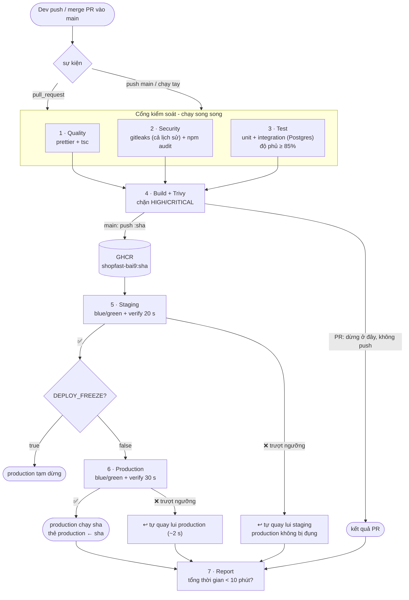

# Bài 9 – Nền tảng triển khai tự động cho ShopFast

> *"Tôi muốn triển khai trở thành việc nhàm chán."* – Giám đốc kỹ thuật

Pipeline: [`.github/workflows/bai9-pipeline.yml`](../.github/workflows/bai9-pipeline.yml) (điều phối 7 giai đoạn) và [`.github/workflows/bai9-deploy.yml`](../.github/workflows/bai9-deploy.yml) (giai đoạn triển khai dùng chung).

---

## 1. Bản đặc tả: thu hẹp yêu cầu mở

### 1.1 "Nhàm chán" nghĩa là gì, đo được
Mình dịch câu nói của giám đốc kỹ thuật thành 5 cam kết có thể kiểm chứng:

| # | Cam kết | Đo bằng |
|---|---|---|
| C1 | **Merge là đủ.** Không có bước thủ công nào giữa `git merge` và production | Pipeline chạy tự động trên `main`. Production không có nút bấm hay người duyệt |
| C2 | **Mã không đạt chuẩn không bao giờ tới được môi trường nào** | 4 cổng tự động: chất lượng, bảo mật, test + độ phủ, quét image |
| C3 | **Bản lỗi tự rút lui trong vài giây, không cần ai trực** | Kiểm tra sau triển khai có ngưỡng cụ thể. Trượt ngưỡng thì tự quay lui |
| C4 | **Nhanh đến mức không ai phải chờ:** < 10 phút từ merge tới production | Giai đoạn 7 đo tổng thời gian của chính lần chạy |
| C5 | **Không có bí mật nào trong mã nguồn** | gitleaks quét **toàn bộ lịch sử git** ở mỗi lần chạy |

Chiều thứ Sáu đáng sợ vì một lần deploy hỏng cần người thức để sửa. Khi C2 chặn bản lỗi từ trước, còn C3 tự rút bản lỗi lọt qua, thì thứ Sáu không còn khác ngày thường. Nếu thật sự cần dừng (ví dụ flash sale), chỉ cần **một biến** `DEPLOY_FREEZE=true` là production tạm dừng, còn staging vẫn chạy.

### 1.2 Chọn những gì, và vì sao

| Lựa chọn | Lý do | Đã cân nhắc nhưng không chọn |
|---|---|---|
| **3 cổng chạy song song** (chất lượng ∥ bảo mật ∥ test) | Cả 3 độc lập nhau. Chạy song song tiết kiệm ~2 phút trong ngân sách 10 phút | Chạy tuần tự: dễ đọc hơn nhưng chậm gấp 3 |
| **Ngưỡng độ phủ 85 % dòng / 75 % nhánh**, đo trên unit + integration | Độ phủ hiện tại 95 %. Ngưỡng 85 % chặn được "tính năng merge không kèm test" (demo: tụt xuống 72 %) mà không làm phiền khi sửa nhỏ | 100 %: tốn công viết test cho code hiển nhiên. Chỉ đo unit: bỏ sót tầng DB |
| **gitleaks quét cả lịch sử git**, không chỉ commit mới | Khoá từng commit rồi xoá vẫn nằm trong lịch sử. Quét cả repo chỉ mất ~6 s | Chỉ dựa vào GitHub secret scanning: không chặn được pipeline |
| **`npm audit --omit=dev --audit-level=high`** | Chỉ phụ thuộc chạy trong production mới đáng chặn | Chặn cả devDependencies: báo động giả liên tục |
| **Trivy quét image, chặn HIGH/CRITICAL có bản vá** | Lần quét đầu **tìm ra 26 lỗ hổng thật** trong base image (npm đi kèm + OpenSSL cũ). Đã sửa trong [Dockerfile](Dockerfile) | Chặn cả lỗ hổng chưa có bản vá: không ai sửa được, pipeline đỏ mãi |
| **Build sau khi qua cổng**, quét **trước khi push** | Kho chỉ chứa image đã qua mọi cổng | Build song song với test: nhanh hơn ~1 phút, nhưng kho sẽ có image chưa kiểm chứng |
| **Staging rồi production, tự động hoàn toàn** | Hai môi trường dùng cùng job, cùng tiêu chí (production chặt hơn). Staging bắt lỗi trước khi tới khách | Người duyệt production như bài 7: đi ngược C1 và tốn thời gian chờ. Ở đây cổng tự động + tự quay lui đóng vai trò đó |
| **Blue/green + kiểm tra dưới tải + tự quay lui** | Bài 8 đã chứng minh: quay lui 3 s, 0 lỗi | Canary nhiều bước: an toàn hơn chút nhưng không vừa ngân sách 10 phút |
| **Tiêu chí quay lui là chỉ số người dùng cảm nhận** (tỉ lệ lỗi, p95, đủ mẫu, không restart, đúng phiên bản) | Đó chính là thứ làm khách hàng khó chịu | Chỉ kiểm tra `/health`: bản chậm 800 ms vẫn báo "khoẻ" |

---

## 2. Kiến trúc

### 2.1 Sơ đồ từ commit tới môi trường thật



### 2.2 Bảng giai đoạn

| Giai đoạn | Đầu vào | Đầu ra | Tiêu chí thành công | Khi thất bại |
|---|---|---|---|---|
| **1 · Quality gate** | Mã nguồn tại commit | – | `prettier --check` không có khác biệt. `tsc --noEmit` 0 lỗi | Pipeline dừng, không build. PR đỏ |
| **2 · Security gate** | Toàn bộ lịch sử git, `package-lock.json` | – | gitleaks: **0 khoá**. `npm audit`: **0** lỗ hổng high/critical trong phụ thuộc production | Dừng, không build. Log gitleaks chỉ ra file/commit (đã che giá trị) |
| **3 · Test gate** | Mã nguồn, Postgres 16 (service container) | Bảng độ phủ trong summary | 100 % test pass **và** độ phủ ≥ 85 % statements/lines/functions, ≥ 75 % branches | Dừng, không build. Summary hiện số độ phủ so với ngưỡng |
| **4 · Build + image scan** | Mã đã qua 1–3 | `ghcr.io/<owner>/shopfast-bai9:<sha>` (không push khi là PR) | Build thành công. Trivy: **0** HIGH/CRITICAL có bản vá | Image **không được push**, không deploy |
| **5 · Staging** | Image `:sha`, `environments/staging.env`, secret `DB_PASSWORD` của Environment *staging* | Staging chạy `sha`, thẻ `staging` ← sha | Migrate OK, candidate *ready*, verify 20 s: lỗi ≤ 2 %, p95 ≤ 500 ms, ≥ 300 request, 0 restart, mọi phản hồi đúng `sha` | **Tự quay lui** về bản trước. Production **không** chạy |
| **6 · Production** | Như trên với `production.env`, Environment *production* | Production chạy `sha`, thẻ `production` ← sha, `production-previous` ← bản cũ | Như trên nhưng chặt hơn: lỗi ≤ **1 %**, p95 ≤ **400 ms**, ≥ 650 request trong 30 s | **Tự quay lui** về bản trước trong ~2 s. Thẻ `production` giữ nguyên. Pipeline đỏ |
| **7 · Report** | Kết quả các giai đoạn | Bảng tổng kết + thời gian trong summary | Tổng thời gian < 600 s | Cảnh báo `::warning` nếu vượt ngân sách |

### 2.3 Tiêu chí phát hiện lỗi sau triển khai (quay lui tự động)
Script [deploy/shared/verify.mjs](deploy/shared/verify.mjs) gửi traffic giả lập qua load balancer ngay sau khi đổi luồng: 90 % vào `/products` (luồng nghiệp vụ), 10 % vào `/ready`. Bản mới **bị quay lui** nếu có **một** trong các điều sau:

| Tiêu chí | Staging | Production | Bắt được loại lỗi gì |
|---|---|---|---|
| Tỉ lệ lỗi (non-2xx hoặc lỗi mạng) | > 2 % | > 1 % | Bug gây 500, mất kết nối DB |
| Độ trễ p95 | > 500 ms | > 400 ms | Truy vấn chậm, rò rỉ tài nguyên |
| Số request đo được | < 300 | < 650 | Bản mới quá chậm nên không đủ bằng chứng là khoẻ |
| Container khởi động lại | > 0 | > 0 | Crash, hết bộ nhớ |
| Phản hồi không đến từ bản mới (`X-Version`) | > 0 | > 0 | Đổi luồng không thành công |
| **Dừng sớm:** một lát 5 s có lỗi > max(20 %, 10 × ngưỡng) hoặc p95 > 2 × ngưỡng | ✓ | ✓ | Bản hỏng nặng bị rút sau **5 giây** thay vì chờ hết cửa sổ |

Quay lui = trỏ nginx về bộ container cũ (vẫn đang chạy) → kiểm tra lại bản cũ trong 5 s → dừng bản mới. Thẻ `<env>` trên GHCR **không** được dời.

---

## 3. Tổ chức cấu hình: dùng chung / riêng môi trường / biến số

```
.github/workflows/
  bai9-pipeline.yml        DÙNG CHUNG  thứ tự giai đoạn, các cổng
  bai9-deploy.yml          DÙNG CHUNG  một định nghĩa job deploy cho mọi môi trường
bai9/deploy/
  shared/                  DÙNG CHUNG  cùng một cách triển khai ở mọi nơi
    compose.yml              topology: db, stable, candidate, migrate, lb
    nginx.conf               load balancer, retry
    deploy.sh                rollout → verify → promote | tự quay lui
    verify.mjs               tiêu chí phát hiện lỗi
  environments/            RIÊNG TỪNG MÔI TRƯỜNG (không bí mật, review như code)
    staging.env              1 container, verify 20 s, lỗi ≤ 2 %, p95 ≤ 500 ms
    production.env           2 container, verify 30 s, lỗi ≤ 1 %, p95 ≤ 400 ms
```

| Lớp | Ở đâu | Ví dụ | Ai thay đổi, bằng cách nào |
|---|---|---|---|
| **Dùng chung** | `deploy/shared/`, 2 workflow | Thứ tự bước, logic quay lui | PR + review |
| **Riêng môi trường, không bí mật** | `deploy/environments/<env>.env` | `APP_REPLICAS`, `MAX_ERROR_RATE`, `VERIFY_SECONDS` | PR + review. Có lịch sử git |
| **Bí mật riêng môi trường** | **GitHub Environment secrets** | `DB_PASSWORD` (khác nhau giữa staging và production) | Settings → Environments. Không bao giờ xuất hiện trong repo hay log (GitHub tự che) |
| **Bí mật nền tảng** | `secrets.GITHUB_TOKEN` | Đăng nhập GHCR | GitHub tự cấp cho từng lần chạy, hết hạn khi job xong |
| **Biến số lúc chạy** | Input của workflow / output của giai đoạn trước | `version` = commit SHA, `inject_fault` | Mỗi lần chạy |
| **Công tắc vận hành** | **Repository variable** | `DEPLOY_FREEZE=true` | Settings → Variables, có hiệu lực ngay, không cần commit |

---

## 4. Cài đặt trên GitHub (một lần)

1. **Settings → Environments → New environment `staging`** → *Add environment secret* `DB_PASSWORD` = một chuỗi ngẫu nhiên (ví dụ `openssl rand -hex 24`).
2. **New environment `production`** → `DB_PASSWORD` = một chuỗi ngẫu nhiên **khác**.
   Không đặt *Required reviewers*: production triển khai tự động, xem lý do ở mục 1.2.
3. Không cần secret nào khác. GHCR dùng `GITHUB_TOKEN`.

> ⚠️ **Phải tạo hai Environment và secret trước lần push đầu tiên.** Nếu chưa có, GitHub sẽ tự tạo Environment trống và giai đoạn 5 dừng với thông báo `Secret DB_PASSWORD is not set on environment 'staging'`. Đây chính là lý do lần chạy `bai7 CD` trước đó bị đỏ.

---

## 5. Kịch bản demo

Làm theo thứ tự. Kịch bản 3 cần production đã có một bản chạy tốt từ kịch bản 1.

### Kịch bản 1: Triển khai thành công
```bash
git add .github/workflows/bai9-*.yml bai9
git commit -m "feat(bai9): automated delivery platform"
git push
```
**Kỳ vọng:** Actions → *bai9 Pipeline*: cả 7 giai đoạn xanh.
- Summary của **5 · Staging** và **6 · Production**: `✅ deployed <sha>`, kèm bảng tỉ lệ lỗi, p95, số request.
- **7 · Report**: `Pipeline: Xm Ys - ✅ under the 10-minute budget`.

Chụp ảnh đồ thị job và summary.

### Kịch bản 2: Bị cổng kiểm soát chặn (tính năng không có test)
```bash
git switch -c demo/no-tests
cp bai9/demo/untested-promotion.ts bai9/src/promotion.ts
git add bai9/src/promotion.ts && git commit -m "feat: promotions (no tests)"
git push -u origin demo/no-tests          # rồi mở PR vào main
```
**Kỳ vọng:**
- **3 · Test gate** đỏ, dù cả 31 test đều pass: `Jest: "global" coverage threshold for statements (85%) not met: 72.45%`.
- **4 · Build** *skipped*, không có image nào được build hay push.

Đã kiểm chứng ở local: độ phủ 95,27 % → 72,45 %, exit 1. Đóng PR và xoá nhánh sau khi chụp.

> Cổng bí mật cũng chặn được tương tự. Ở local, một khoá giả `sk_live_…` làm gitleaks thoát mã 1. Mình không đưa demo này lên GitHub, vì *push protection* của GitHub có thể chặn ngay từ lúc push.

### Kịch bản 3: Quay lui tự động
**Actions → bai9 Pipeline → Run workflow** (branch `main`): `inject_fault = errors`, `fault_environment = production`.

**Kỳ vọng:**
- Giai đoạn 1–5 xanh: staging nhận bản *không* lỗi.
- **6 · Production** đỏ, summary ghi `↩️ AUTOMATIC ROLLBACK to <sha cũ> in ~2000 ms`. Bảng cho thấy lỗi ~25 % > 1 %, `fast fail: … errors in 5 s`.
- Thẻ `production` trên GHCR **không đổi**.

Chạy thêm một lần với `inject_fault = latency` để thấy tiêu chí p95 (~815 ms > 400 ms) cũng kích hoạt quay lui.

> `inject_fault` mô phỏng một bản **qua hết mọi test** nhưng hỏng khi chạy thật (lỗi cấu hình, phụ thuộc ngoài chậm). Nó chỉ được bật khi chạy tay, và chỉ áp cho bản mới ([src/fault.ts](src/fault.ts)).

### Ghi lại lịch sử chạy thật
| Kịch bản | Link run | Tổng thời gian | Kết quả |
|---|---|---|---|
| 1 · Triển khai thành công | _dán link_ | _(từ 7 · Report)_ | |
| 2 · Bị chặn bởi cổng độ phủ | _dán link_ | | |
| 3 · Quay lui tự động (errors) | _dán link_ | | |

---

## 6. Kiểm chứng không có bí mật trong mã nguồn
```bash
# cùng lệnh mà giai đoạn 2 chạy - toàn bộ lịch sử git của repo:
docker run --rm -v "$PWD:/repo" zricethezav/gitleaks:v8.21.2 git /repo --redact --no-banner -v
# -> "no leaks found"
```
- Không có giá trị nhạy cảm nào trong `deploy/environments/*.env`.
- DB của CI dùng `trust` auth, vì là container dùng một lần nên không cần mật khẩu.
- Mật khẩu DB của staging/production chỉ có trong GitHub Environment secrets.

---

## 7. Kết quả đã đo ở local (trước khi đưa lên GitHub)

| Hạng mục | Kết quả |
|---|---|
| Test | 31/31 pass. Độ phủ 95,27 % statements, 94,82 % branches |
| Cổng độ phủ với file demo | 72,45 % → exit 1 (bị chặn) |
| gitleaks: thư mục bài 9 / cả lịch sử repo / khoá giả | sạch / sạch / **phát hiện, exit 1** |
| npm audit (prod) | 0 lỗ hổng |
| Trivy, image ban đầu (bài 7) | **26 HIGH/CRITICAL** (22 trong npm đi kèm, 4 OpenSSL) |
| Trivy, image bài 9 (đã gỡ npm, `apk upgrade`) | **0**, image 211 MB, chạy bằng uid 1000 |
| Deploy production, bản tốt | verify 1.350 request, 0 lỗi, p95 12 ms → promoted |
| Deploy production, `errors` | Dừng sớm sau 5 s (lỗi 24,8 %) → **quay lui trong 2,0 s** |
| Deploy production, `latency` | Dừng sớm sau 6 s (p95 816 ms) → **quay lui trong 2,4 s** |
| Chế độ state `registry` (thẻ con trỏ trên GHCR) | Kiểm tra với registry tạm: thẻ không dời khi quay lui |

Trong lúc kiểm thử, mình phát hiện bộ đo `verify.mjs` dùng `setInterval` bị hệ điều hành làm chậm (Windows ~21 thay vì 30 req/s). Kết quả là một bản **khoẻ** bị đánh trượt vì "không đủ request". Mình đã sửa bằng cách đặt lịch theo thời gian thực, sau đó đo được chính xác 1.350/1.350 request.

## 8. Giới hạn đã biết
- **Môi trường là giả lập.** Runner của GitHub là máy dùng một lần. `deploy.sh` thật sự dựng DB, bản đang chạy (stable) và bản mới (candidate) trên runner, rồi đổi luồng, đo và quay lui. Phiên bản đang chạy của mỗi môi trường được ghi bằng thẻ `staging` / `production` trên GHCR, nên mỗi lần chạy đều biết bản trước để quay về. Với server thật thì chạy cùng `deploy.sh` trên self-hosted runner, đặt `DEPLOY_STATE=file`.
- DB của mỗi lần chạy là DB mới. Vì vậy quy tắc migration tương thích ngược (expand/contract) đã chứng minh ở bài 7–8 vẫn là điều kiện bắt buộc trên server thật.
- Ngưỡng hiện tại phù hợp với traffic giả lập. Production thật nên lấy ngưỡng từ baseline của hệ thống giám sát (ví dụ p95 của 7 ngày gần nhất × 1,5).
